<!--
  README de perfil · Yerzyd David Alcon Bustos
  Paleta (tomada de tu terminal): #4C1D95 · #7C3AED · #A78BFA · #C084FC · #E879F9 sobre #140F2E
  Busca "EDITA" para personalizar. Los gráficos animados están en /assets (SVG propios).
-->

 

  

 

## 🧭 Qué hago y para quién

Ayudo a **municipios, empresas e instituciones** a tomar mejores decisiones con **datos del territorio**: levantamientos con drones, catastro, análisis satelital, modelación hidrológica y software a medida. Soy **Ingeniero Geógrafo** y **Mayor del Ejército de Bolivia** (Arma de Caballería), con más de 19 años de servicio, y combino la disciplina de campo con **Python, R, Machine Learning, Big Data y Cloud**.

Con mi empresa, **Soluciones Visionarias Yerzyd**, convierto datos geoespaciales en herramientas que se pueden usar: mapas, dashboards, plugins y sistemas.

 

## 💼 Servicios

  

 

## 🎯 Cómo trabajamos juntos

  

 

<!-- EDITA: ajusta los paquetes a lo que realmente ofreces y agrega precios si quieres -->
| 🔎 Diagnóstico | 🛠️ Proyecto a medida | 🎓 Capacitación | 🤝 Soporte continuo |
|:---|:---|:---|:---|
| Revisión de tus datos y necesidades, con alcance y plazos claros. | Levantamiento, análisis, mapas, plugins o sistemas, con entregables definidos. | Cursos online en geomática y análisis de datos espaciales, para equipos o personas. | Mantenimiento, mejoras y actualización de lo entregado. |
| **Cotización:** consultar | **Cotización:** a medida | **Cotización:** consultar | **Cotización:** consultar |

  
  
  

## 🛰️ Experiencia comprobable

  
   
  

 

**Proyectos que he liderado:** cartoclasificación · catastro y planimetría · zonificación y valuación zonal · apoyo a desastres naturales con drones · delimitación de unidades territoriales · diseño e implementación de sistemas de riego.

## 🎓 Formación por áreas

  

 

**Licenciaturas:** Ciencias y Artes Militares Terrestres (Colegio Militar del Ejército) · Ingeniería Geográfica (Escuela Militar de Ingeniería).
**Maestrías:** Ordenamiento Territorial y Planificación Urbana · MBA · Big Data y Analítica de Datos · Recursos Hídricos y Riego.
**Diplomados clave:** Machine & Deep Learning · Big Data y Cloud Computing · Python y R · Geoinformática y Análisis Geoespacial · Catastro y Planificación Territorial · BIM · Marketing Digital.
**Idiomas:** inglés intermedio · francés y portugués básicos.

## 🧰 Herramientas

  
    
  

## 🚀 Actividad en GitHub

<!-- Cuadro de contribuciones con la paleta de tu terminal (lo genera el workflow .github/workflows/snake.yml) -->

 

<!-- Gráfico de actividad reciente con tu paleta -->

<!-- EDITA: cambia "repo=" por tus repos públicos. Los privados no se muestran. -->

  
  
   
  
  
   
  
  

 

  
  

<!-- Si las tarjetas fallan es el servicio público de Vercel; borra estos bloques o intenta más tarde. -->

 

## 📬 ¿Tienes un proyecto en mente?

Cuéntame qué necesitas y te respondo con un diagnóstico y una propuesta técnico-económica.

  
    
  
  
  
  
   
  
  
  

